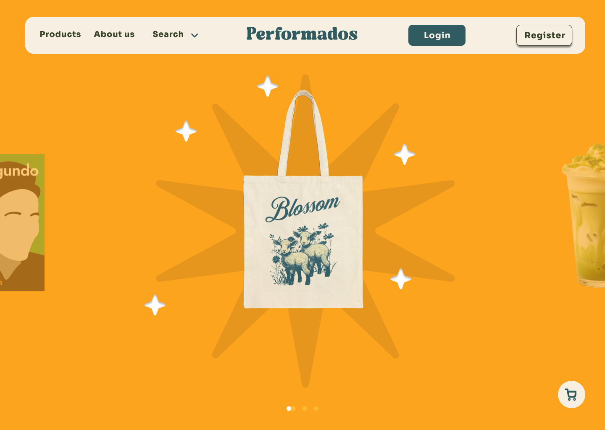
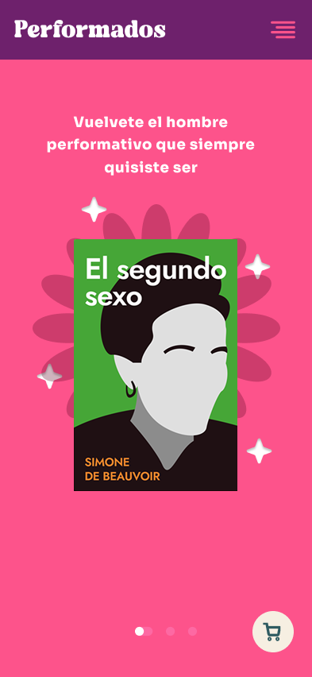
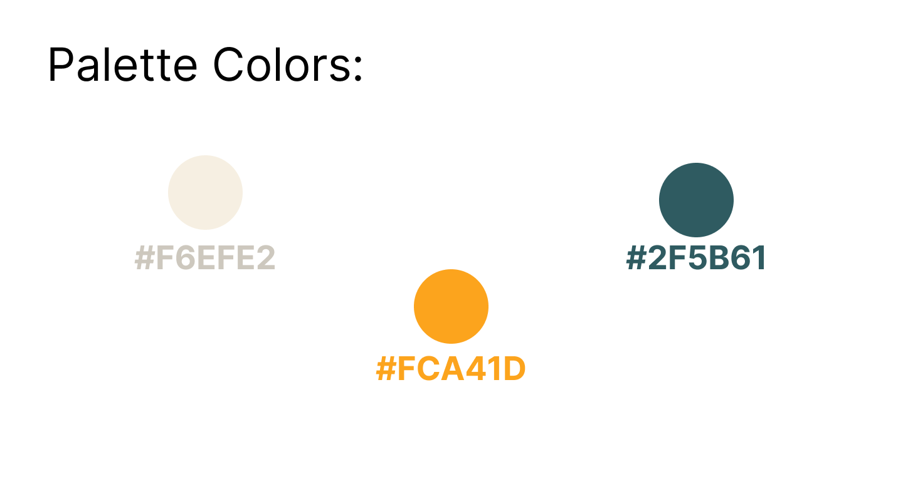
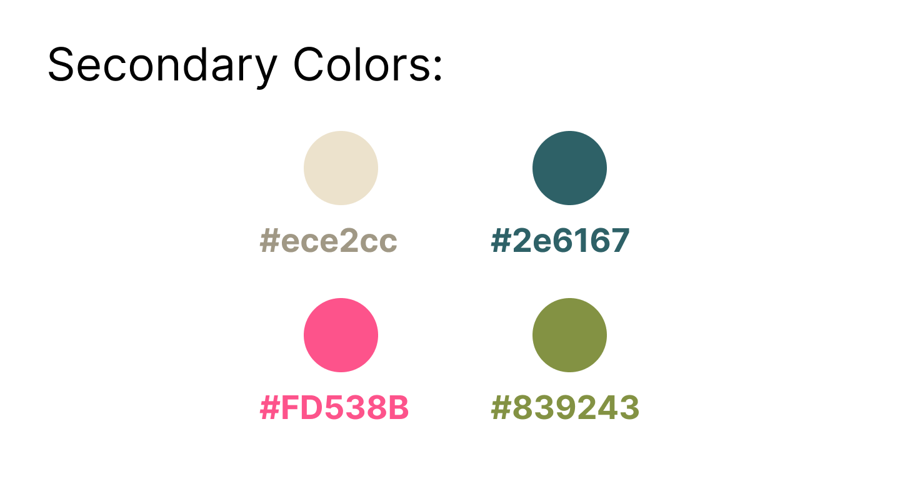
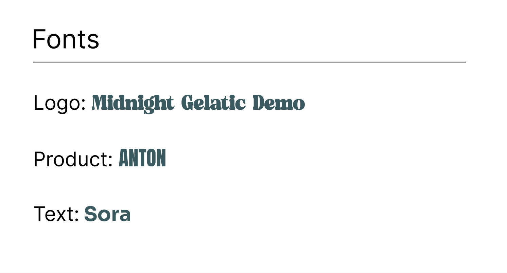
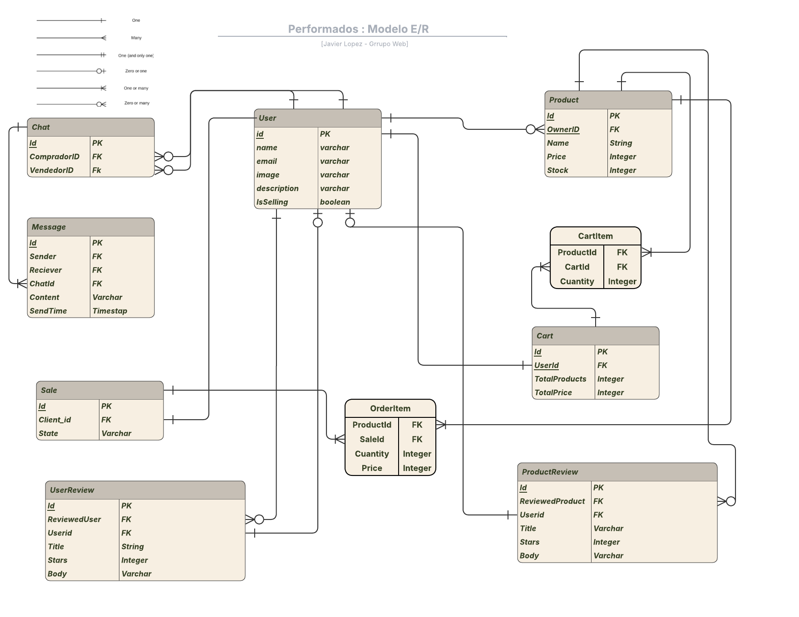

# Performados - Frontend 

## Grupo Javier Lopez - IIC2513-1 2025-2

### Integrantes:
- Vicente Cuitiño 
- Esteban Ortega
- Miguel Ulloa

### Descripcion del Proyecto

¡Bienvenido a la nueva plataforma de compra y venta de productos para hombres performativos!

Nuestro proyecto, es un eCommerce orientado a todos aquellos hombres que rompen con lo cotidiano. Por medio de nuestra app, los usuarios registrados podrán publicar y comprar productos orientados a la moda performativa

La idea del proyecto nace de que notamos que no existen tiendas específicas de esta categoría de productos. Por lo que esta página esta totalmente orientada a las personas interesadas en este estilo de vida.

Las funcionalidades minimas de la pagina, incluyen un carro de compras, perfiles de usuario, sistema de compras, reviews de productos, chat en linea para comunicacion entre cliente y vendedor, entre otras.

## Vistas principales (Mockups)

  
  
  

## Paleta de colores 

## Fuentes

## Logo

## Diagrama E/R

## Historias de Usuario

- Como usuario registrado o no registrado, quiero poder ver los productos en stock, para ver lo que puedo comprar.

- Como usuario registrado o no, quiero poder agregar productos en stock a mi carro de compras, especificando la cantidad mientras quede stock, para poder comprar más de un producto a la vez.

- Como usuario registrado o no, quiero poder ver mi carro, para poder administrarlo o proceder al pago.

- Como usuario registrado o no, quiero poder editar mi carro, para eliminar productos que ya no quiero comprar.

- Como usuario no registrado, quiero poder crear una cuenta, para poder comprar los productos, vender y dejar reseñas.

- Como usuario no registrado, quiero poder ingresar a mi cuenta anteriormente creada, con mi mail y mi contraseña, para poder comprar o vender productos, dejar reseñas y/o editar mi perfil.

- Como usuario registrado, quiero poder editar mi perfil, cambiando mi nombre, correo, foto, o contraseña, para poder actualizar mis datos.

- Como usuario registrado, quiero poder hacer una reseña al vendedor luego de hacer una compra de uno de sus productos, para recomendar o no recomendar al vendedor.

- Como usuario registrado, quiero poder hacer una reseña de cualquier producto de la página, para recomendar o no el producto.

- Como usuario registrado, quiero poder ver el estado de mis pedidos, para saber si ya fueron enviados, recibidos, o se están procesando.

- Como usuario registrado, quiero poder ver mi perfil, para saber cuales son mis datos.

- Como vendedor, quiero poder ser notificado que uno de mis productos fue vendido exitosamente, para poder ver al comprador y poder contactarme con el

- Como vendedor quiero poder cambiar el estado de los productos que me compraron, para informar a los clientes.

- Como vendedor quiero poder ver los productos que me han comprado y su estado de entrega, para organizar mis pedidos.

- Como usuario registrado o no registrado, quiero poder ver las reseñas de un producto, para saber si comprarlo o no.

- Como usuario registrado o no registrado, quiero poder ver las reseñas sobre un vendedor, para orientarme al comprar sus productos.

- Como usuario registrado, quiero poder ver mi historial de compras, para saber que productos compré en la página.

- Como usuario registrado o no registrado, quiero poder saber si un producto es de la tienda oficial, para saber si comprarlo o no.

- Como usuario registrado o no, quiero poder ver el perfil de un vendedor, para poder saber si comprar sus productos.

- Como usuario registrado, quiero poder ingresar mis datos de pago y envío (falsos), para poder completar mi compra.

- Como usuario administrador, quiero poder eliminar cualquier producto, para administrar la tienda.

- Como usuario administrador, quiero poder eliminar una publicación, para poder moderar el contenido que se publica.

- Como usuario administrador, quiero poder eliminar una reseña, para poder moderar las interacciones entre usuarios.

- Como usuario administrador, quiero poder eliminar un usuario, para poder administrar la página.

- Como usuario administrador, quiero poder editar cualquier reseña, para filtrar contenido inapropiado.

- Como usuario administrador, quiero poder editar cualquier usuario, para filtrar contenido inapropiado.

- Como usuario administrador, quiero poder editar cualquier producto, para actualizar el contenido del producto.

- Como usuario con sesión iniciada, quiero poder cerrar sesión, para que no quede mi cuenta y mis datos siempre conectados en el dispositivo.

- Como usuario registrado o no, quiero ser capaz de filtrar productos, para encontrar fácilmente los productos que se adecuen a mis preferencias.

- Como usuario administrador, quiero ser capaz de publicar un producto oficial, para que este se distinga del resto de productos de usuarios vendedores sin verificar.

- Como usuario registrado, quiero ser capaz de publicar mis artículos a vender, para poder generar ingresos a través de la plataforma.

- Como usuario administrador, quiero contar con un panel de estadísticas, para analizar el tráfico de la plataforma, ventas realizadas en el último tiempo, etc.

- Como usuario administrador, quiero poder crear categorias de interes para usuarios, asi poder volver más atractiva la plataforma con secciones de descuentos semanales/diarios, ofertas por temporada, etc.